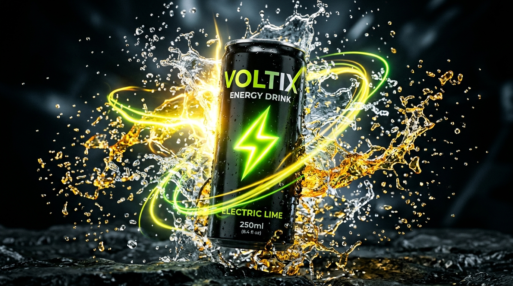

# VOLTIX — Unleash Your Energy

> A futuristic, cinematic 3D energy drink brand website built with React, Vite, Tailwind CSS, GSAP ScrollTrigger, and Framer Motion.



## Features

- **100-Frame Scroll-Driven Canvas Hero**: Smooth 60 FPS lerp scrubbing that plays in both directions (scroll down and scroll up).
- **Interactive Multi-Phase Narrative**: Seamless transitions across 4 energy phases:
  - Phase 0: Vitalizes Body & Mind // Zero Crash
  - Phase 1: First Sip Bio-Activation
  - Phase 2: Pure Kinetic Flow State
  - Phase 3: Cold-Vault Aluminum Can
- **Tri-Spectrum Product Showcase**: Original, Berry Blast, and Citrus Rush with 3D parallax scroll and flavor-shifting ambient illumination.
- **Red Bull-Inspired Occasions ("When to Drink")**: Long journeys, deep work & coding, competitive esports, and hybrid athletics.
- **Brand Editorial & Philosophy**: High-speed explosive burst visual and 3 core formulation pillars.
- **Transparent Ingredients & Nutrition Facts Modal**: 180mg green coffee caffeine, L-Theanine, taurine, electrolytes, and zero sugar.
- **Harmonic Wave Synthesizer & Telemetry Studio**: Real-time canvas oscilloscope visualizer with interactive frequency modes.
- **Re-Triggering Benchmarks & Milestones**: Live animated counters that count up on scroll both ways.
- **Lifestyle Bento Applications**: High-octane cards for gaming, night running, creative code, and music.
- **Animated Navigation Tabs**: Framer Motion layoutId sliding pill animation with spring physics, active scroll-spy, and mobile drawer.
- **Audio Feedback System**: Web Audio API synthesized neon UI sound effects (toggleable).
- **Theme Switching**: Dark and light themes via CSS custom variables.
- **Instant Quick-Buy Modal**: Pack size, flavor selector, and celebratory confetti.

## Tech Stack

- **Framework**: React 18 + Vite
- **Styling**: Tailwind CSS + CSS Custom Properties
- **Scroll & Timeline Animations**: GSAP 3 + ScrollTrigger + Lenis Smooth Inertia Scroll
- **Component & Tab Animations**: Framer Motion
- **Icons**: Lucide React
- **Celebration Effects**: Canvas Confetti

## Getting Started

### Prerequisites

- Node.js (v18 or higher recommended)
- npm or yarn

### Installation

```bash
# Clone the repository
git clone https://github.com/kishanarva/energy-drink.git

# Enter project directory
cd energy-drink

# Install dependencies
npm install

# Start development server
npm run dev
```

### Production Build

```bash
# Compile optimized bundle
npm run build

# Preview build locally
npm run preview
```

## License

MIT License © 2026 VOLTIX.
